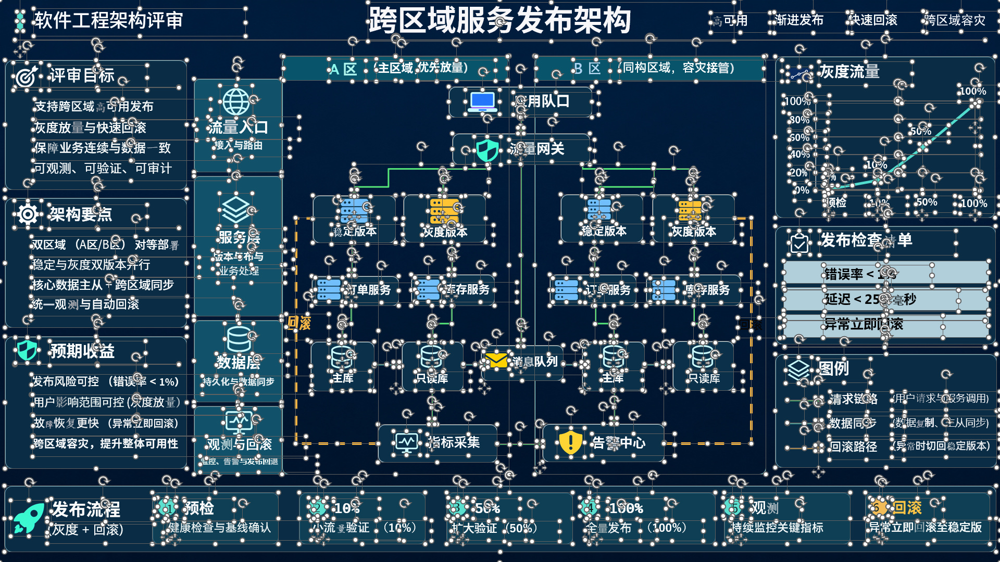
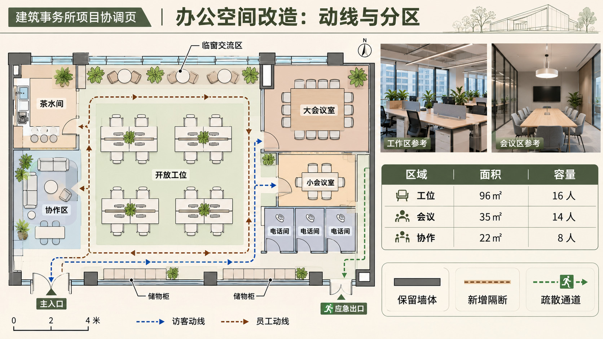
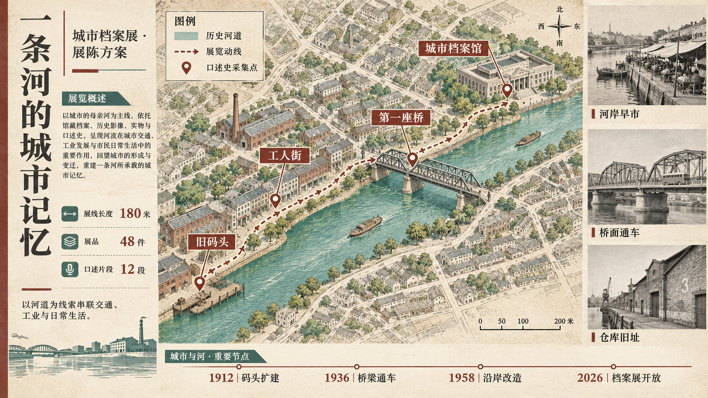
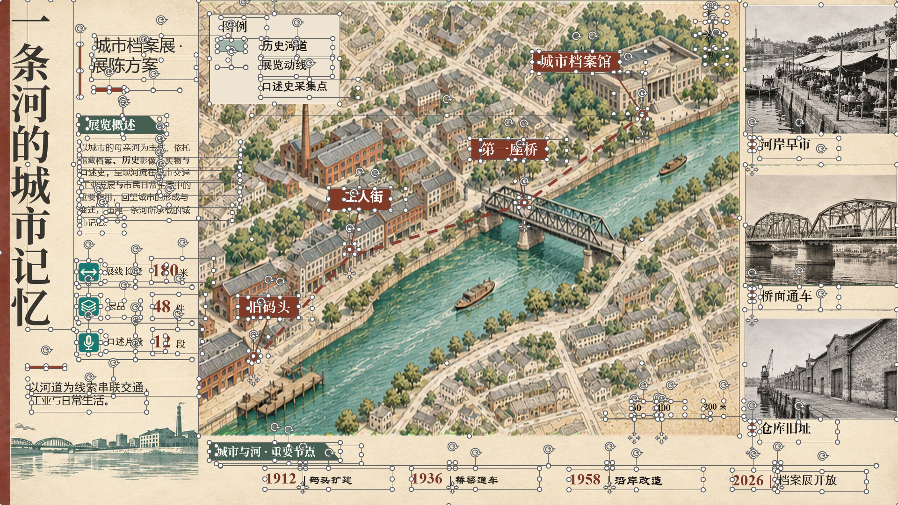

<h1 align="center">Slide Alchemy</h1>

<p align="center">
  <b>English</b> | <a href="README.zh-CN.md">简体中文</a>
</p>

<p align="center">
  <strong>🧪 Reforge image-based slides into TRULY EDITABLE, component-based PowerPoint decks.</strong>
</p>

> Turn a slide screenshot, scanned deck, or image-based PPTX into a PowerPoint you can actually edit: real text boxes, native geometry, and stable visual assets.

[](https://github.com/CodingFeng101/slide-alchemy/stargazers)
[](LICENSE)

If this saves you from rebuilding a deck by hand, please **star the repo** so more people working with AI-generated slides can find it.

Slide Alchemy is a skill for Codex and Claude Code that rebuilds picture-style PPT/PPTX files, slide screenshots, and scanned visual decks into editable `.pptx` files. It does not place a full-slide screenshot back into PowerPoint and call it editable. It separates each page into a clean base background, editable geometry, generated PNG assets, and real text boxes.

```text
source slide image
-> clean base background
-> component classification
-> editable geometry + generated PNG assets + real text
-> editable PPTX
```

## 🎬 Demo Video

https://github.com/user-attachments/assets/da4675ac-5296-4938-b162-6c674a16d19f

## ✨ Core Strengths

| Strength | What It Means |
| --- | --- |
| 🪙 **Lower token use** | Pages are analyzed into reusable components, so repeated slide objects do not need to be described and rebuilt from scratch. |
| ⚡ **Faster reconstruction** | Repeated cards, stars, lines, title bars, and icon assets are generated once, then reused across slides. |
| ✍️ **Editable text** | Normal slide text becomes real PowerPoint text boxes, not rasterized text. |
| 📏 **Measured text layout** | OCR reads the characters; position, font size, colour, weight, bullets, and line spacing are measured from the pixels instead of estimated by a vision model. |
| 📐 **Editable geometry** | Lines, stars, cards, title bars, circles, borders, and other simple shapes become editable PPT objects when practical. |
| 🧩 **Stable complex icons** | Badges, illustrations, glow effects, and detailed icons stay as transparent PNG assets instead of brittle over-splitting. |
| 🖼️ **AI-cleaned bases** | Backgrounds are regenerated with an image editing model, not covered with white masks or rough local inpainting. |
| ✨ **Generated icon assets** | PNG icons and complex PNG components are generated with an image generation/editing model, then sliced from the generated asset sheet. They are never cropped directly from the original slide screenshot. |

Token and timing benchmarks will be added after measurement.

## 🖥️ Examples

### Retail performance

| Image-based slide | Editable PPTX (objects selected) |
| --- | --- |
|  |  |

### Cross-region release architecture

| Image-based slide | Editable PPTX (objects selected) |
| --- | --- |
|  |  |

### Warehouse redesign

| Image-based slide | Editable PPTX (objects selected) |
| --- | --- |
|  |  |

### Pendulum experiment

| Image-based slide | Editable PPTX (objects selected) |
| --- | --- |
|  |  |

### Office space planning

| Image-based slide | Editable PPTX (objects selected) |
| --- | --- |
|  |  |

### Self-service pilot

| Image-based slide | Editable PPTX (objects selected) |
| --- | --- |
|  |  |

### Assembly downtime improvement

| Image-based slide | Editable PPTX (objects selected) |
| --- | --- |
|  |  |

### City archive exhibition

| Image-based slide | Editable PPTX (objects selected) |
| --- | --- |
|  |  |

[Image-based PPTX](examples/03-complex-chinese/image-ppt.pptx) · [Editable PPTX](examples/03-complex-chinese/editable.pptx) · [All eight comparisons](examples/README.md#complex-chinese-slides) · [Clean overview](examples/03-complex-chinese/overview.jpg) · [Original basic examples](examples/README.md#basic-examples)

## 🎯 Why It Exists

Most image-to-PPT workflows fail in one of two ways:

1. ❌ They put the original slide screenshot into PPT and call it "editable".
2. ❌ They slice every visual element into PNGs, making simple shapes hard to edit and icons easy to crop badly.

Slide Alchemy uses a component-based reconstruction strategy:

- ✅ **Bases are image-edited, not masked.**
- ✅ **Simple geometry stays editable.**
- ✅ **Complex icons stay visually stable.**
- ✅ **Repeated pieces are reused.**

## 📦 Installation

### Codex

Ask Codex to install this skill from the repository, then restart Codex:

```text
Install the Codex skill from https://github.com/CodingFeng101/slide-alchemy.git
```

### Claude Code

Ask Claude Code to install it:

```text
Install the skill from https://github.com/CodingFeng101/slide-alchemy.git: copy its skill/slide-alchemy folder into ~/.claude/skills/
```

Or copy it yourself:

```bash
git clone https://github.com/CodingFeng101/slide-alchemy.git
cp -r slide-alchemy/skill/slide-alchemy ~/.claude/skills/
```

Restart Claude Code so it picks up the skill.

Claude Code has no image tool of its own, so the skill calls `scripts/generate_image.py`, which uses an OpenAI-compatible Images API. Set these before starting Claude Code:

```bash
export SLIDE_ALCHEMY_IMAGE_API_KEY=sk-...
export SLIDE_ALCHEMY_IMAGE_BASE_URL=https://api.openai.com/v1   # or your compatible gateway
export SLIDE_ALCHEMY_IMAGE_MODEL=gpt-image-2                     # optional, this is the default
```

On Windows PowerShell, use `$env:SLIDE_ALCHEMY_IMAGE_API_KEY = "sk-..."`, or `setx` to keep the values across sessions.

### Python dependencies

The bundled scripts need their Python dependencies, including the OCR engine used for text extraction. The OCR models ship inside the package, so nothing is downloaded at run time:

```bash
pip install -r skill/slide-alchemy/requirements.txt
```

## 🚀 Usage

In Codex:

```text
Use $slide-alchemy to convert these image-style PPT slides into an editable PPTX.
```

In Claude Code:

```text
/slide-alchemy convert deck.pptx into an editable PPTX
```

## 🧱 Element Strategy

| Category | Use For | Output |
| --- | --- | --- |
| 📐 `simple_geometry_svg_ooxml` | lines, stars, circles, rings, cards, title bars, borders, simple circuit lines | editable PPT geometry |
| 🖼️ `icon_png` | trophy, flowers, book, hands/heart, computer, chain link, badges | transparent PNG |
| 🧩 `complex_png_whole` | swirls, glow-heavy decorations, multi-layer badges, complex illustrations | one whole transparent PNG |
| 📷 `photo_source_crop` | real photographs of people, events, places, documents | cropped from the source page, never regenerated |

Core rule:

> If the element can be described by geometry, fill, and stroke, make it editable. If it depends on texture, glow, shadow, or dense detail, keep it as PNG.

PNG icons and complex PNG components must be generated with an image generation/editing model and then sliced from the generated asset sheet. They must not be cropped directly from the original slide image.

Semantic icons stay PNG by default, even when they are flat or line-art icons. SVG/OOXML is for simple layout geometry, not for rebuilding recognizable icons out of native PPT shapes.

## 📄 License

MIT
