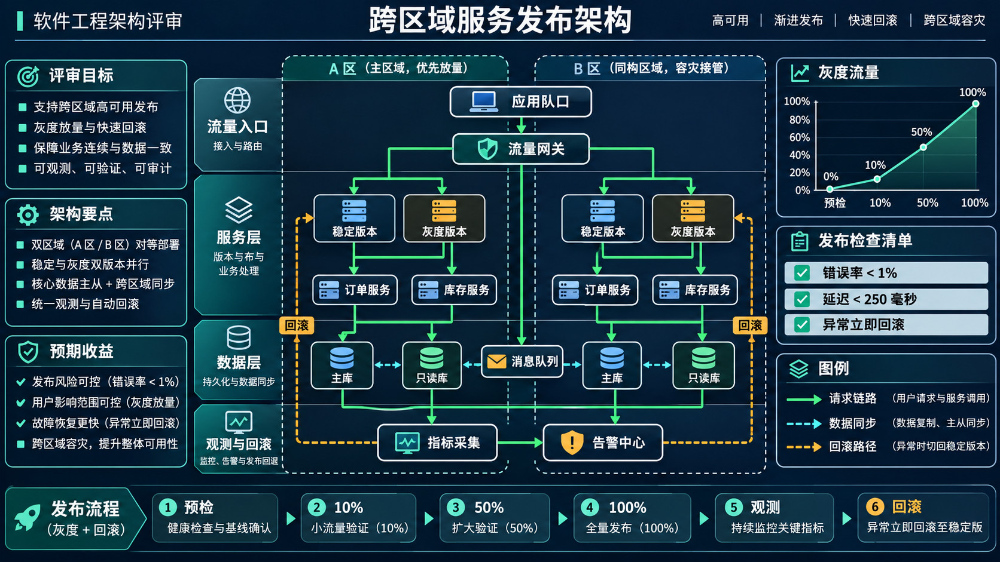
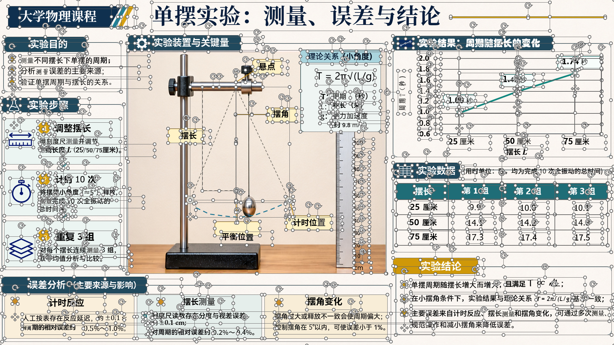
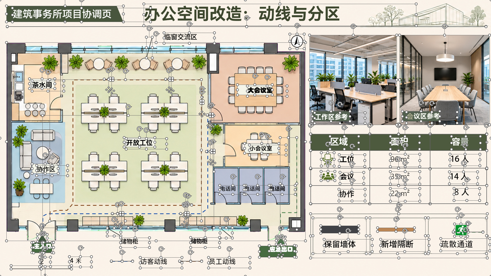

<h1 align="center">Slide Alchemy</h1>

<p align="center">
  <b>English</b> | <a href="README.zh-CN.md">简体中文</a>
</p>

[](https://github.com/CodingFeng101/slide-alchemy/stargazers)
[](LICENSE)

Slide Alchemy is a skill for Codex and Claude Code that rebuilds image-based decks, slide screenshots, and scanned slides as editable PowerPoint files.

## What gets rebuilt

| Source element | PowerPoint output |
| --- | --- |
| Body text, headings, and decorative lettering | Native text boxes. Gradients, outlines, and shadows use native text effects. More complex effects are approximated while keeping the text editable. |
| Lines, borders, cards, and other simple geometry | Individually editable PowerPoint shapes. |
| Icons and complex illustrations | Regenerated PNGs that can be moved, resized, and replaced independently. |
| Real photographs, such as group and event photos | Cropped directly from the source slide and inserted as separate pictures. |
| Slide backgrounds | Clean backgrounds created with an image editing model that removes foreground content. |

## Quick start

After [installation and configuration](#installation-and-configuration), attach the image-based PPTX or slide screenshots. Use `$slide-alchemy` in Codex or `/slide-alchemy` in Claude Code.

**Default mode**

```text
Use slide-alchemy to convert this image-based deck into an editable PPTX.
```

Review the proposed background groups, then review the clean background previews.

**Unattended mode**

```text
Use slide-alchemy to convert this image-based deck into an editable PPTX. Run unattended without intermediate confirmation.
```

Both modes deliver an editable PPTX and comparison previews.

## Workflow

1. **Render the source slides and clean the backgrounds.** Group pages by background and remove foreground content with an image editing model.
2. **Classify and rebuild components.** Convert simple geometry to PowerPoint shapes, slice icons and illustrations from generated asset sheets, and crop real photographs from their source pages. Reuse components that repeat across pages.
3. **Extract text, measure layout, and match fonts.** OCR reads the text, and pixel measurements recover position, size, color, and line spacing. A small local model shortlists up to 10 fonts, then OpenCV compares their glyph shapes. Reruns reuse completed text extraction results when the inputs and settings match.
4. **Compose and compare each slide.** Combine the backgrounds, shapes, pictures, and text, then export previews and record visible differences against the source.

[Full workflow](skill/slide-alchemy/references/workflow.md) · [Text extraction and font matching](skill/slide-alchemy/references/text-extraction.md)

## 🎬 Demo Video

https://github.com/user-attachments/assets/da4675ac-5296-4938-b162-6c674a16d19f

## 🖥️ Examples

### Retail performance

| Image-based slide | Editable PPTX (objects selected) |
| --- | --- |
|  |  |

### Cross-region release architecture

| Image-based slide | Editable PPTX (objects selected) |
| --- | --- |
|  |  |

### Warehouse redesign

| Image-based slide | Editable PPTX (objects selected) |
| --- | --- |
|  |  |

### Pendulum experiment

| Image-based slide | Editable PPTX (objects selected) |
| --- | --- |
|  |  |

### Office space planning

| Image-based slide | Editable PPTX (objects selected) |
| --- | --- |
|  |  |

### Self-service pilot

| Image-based slide | Editable PPTX (objects selected) |
| --- | --- |
|  |  |

### Assembly downtime improvement

| Image-based slide | Editable PPTX (objects selected) |
| --- | --- |
|  |  |

### City archive exhibition

| Image-based slide | Editable PPTX (objects selected) |
| --- | --- |
|  |  |

[Image-based PPTX](examples/03-complex-chinese/image-ppt.pptx) · [Editable PPTX](examples/03-complex-chinese/editable.pptx) · [All eight comparisons](examples/README.md#complex-chinese-slides) · [Clean overview](examples/03-complex-chinese/overview.jpg) · [Original basic examples](examples/README.md#basic-examples)

## Installation and configuration

### Codex

Ask Codex to install the skill from the repository, then restart Codex.

```text
Install the Codex skill from https://github.com/CodingFeng101/slide-alchemy.git using the skill/slide-alchemy directory.
```

### Claude Code

Clone the repository, copy the skill into the Claude Code skills directory, and restart Claude Code.

```bash
git clone https://github.com/CodingFeng101/slide-alchemy.git
cp -r slide-alchemy/skill/slide-alchemy ~/.claude/skills/
```

### Python, image models, and fonts

Install the script dependencies from the repository root.

```bash
python -m pip install -r skill/slide-alchemy/requirements.txt
```

The skill uses the host's image tool when available. For hosts without an image tool, `scripts/generate_image.py` uses an OpenAI-compatible image API. Set `SLIDE_ALCHEMY_IMAGE_API_KEY` before starting the host. Set `SLIDE_ALCHEMY_IMAGE_BASE_URL` and `SLIDE_ALCHEMY_IMAGE_MODEL` for a custom gateway or model.

The OCR model ships with the dependencies, and font matching runs locally by default. If the rebuild needs a missing font, install the cached fonts using the command below, then restart PowerPoint.

```bash
python skill/slide-alchemy/scripts/font_store.py --install-fonts
```

[Font setup and optional remote matching](skill/slide-alchemy/references/font-distribution.md) · [Troubleshooting](skill/slide-alchemy/references/failure-decision-tree.md)

## 📄 License

MIT
