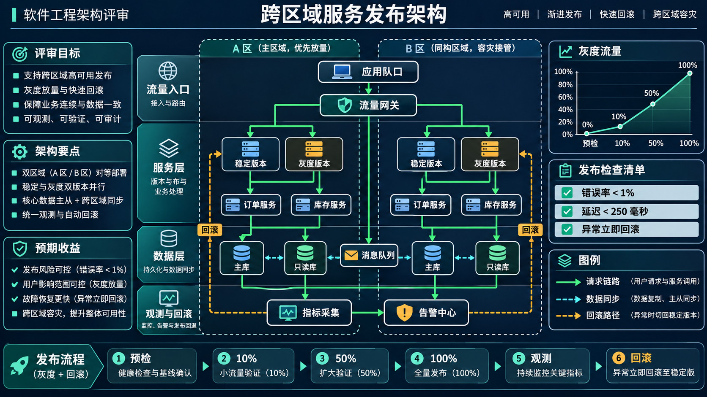
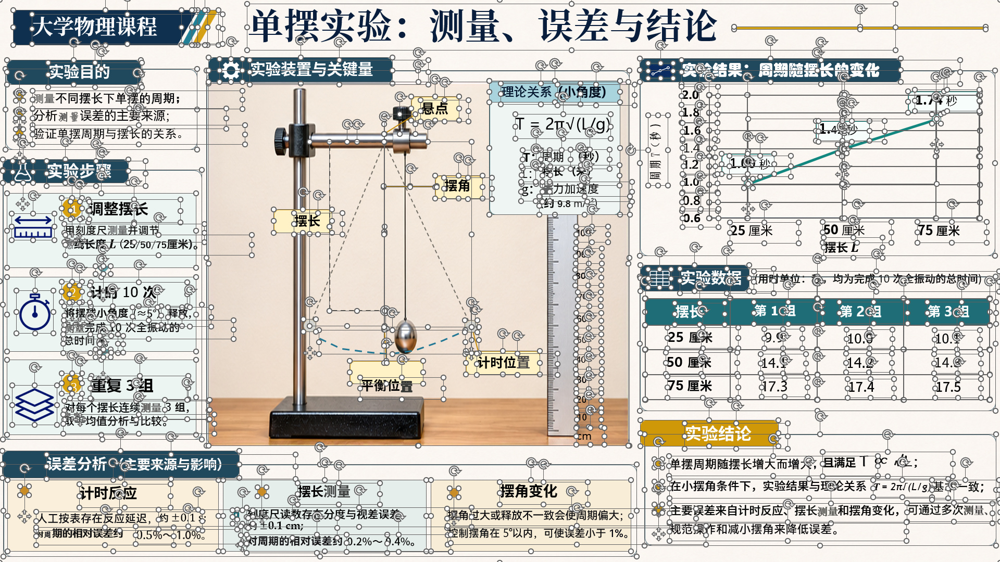

<h1 align="center">Slide Alchemy</h1>

<p align="center">
  <a href="README.md">English</a> | <b>简体中文</b>
</p>

[](https://github.com/CodingFeng101/slide-alchemy/stargazers)
[](LICENSE)

Slide Alchemy 是一个可用于 Codex 和 Claude Code 的 Skill，把图片型 PPT、幻灯片截图和扫描页还原成可编辑的 PowerPoint。

## 能还原什么

| 源页元素 | PowerPoint 中的结果 |
| --- | --- |
| 正文、标题和艺术字 | 原生文本框。渐变、描边和阴影用原生文字效果还原，复杂效果保留可编辑文字并做视觉近似。 |
| 线条、边框、卡片等简单几何 | 可独立编辑的 PowerPoint 形状。 |
| 图标和复杂插画 | 重新生成的独立 PNG，可移动、缩放和替换。 |
| 合影、现场照等真实照片 | 直接从源页裁取，作为独立图片放回。 |
| 页面底图 | 图像编辑模型清理前景内容后生成的净底。 |

## 快速开始

[安装与配置](#安装与配置)后，上传图片型 PPTX 或幻灯片截图。在 Codex 可以用 `$slide-alchemy`，在 Claude Code 可以用 `/slide-alchemy` 调用。

**默认模式**

```text
使用 slide-alchemy，把这份图片型 PPT 转成可编辑的 PPTX。
```

先确认底图分组，再确认净底预览。

**全自动模式**

```text
使用 slide-alchemy，把这份图片型 PPT 转成可编辑的 PPTX。全自动处理，中途不用确认。
```

两种模式都会交付可编辑 PPTX 和对比预览。

## 工作流程

1. **渲染源页并生成净底。** 按页面背景分组，使用图像编辑模型清理底图。
2. **分类并重建组件。** 简单图形转为 PowerPoint 形状，图标和插画从生成的素材图中切出，真实照片从源页裁取。跨页重复的组件可复用。
3. **识字、测量并匹配字体。** OCR 识别文字，从像素测量位置、字号、颜色与行距。小模型在本地筛出最多 10 个候选字体，再用 OpenCV 比较字形。输入和配置相同时，重跑可复用已完成页的文字提取结果。
4. **合成并逐页对比。** 合成底图、图形、图片和文字，导出预览并对照源页检查，记录可见差异。

[完整工作流程](skill/slide-alchemy/references/workflow.md) · [文字提取与字体匹配](skill/slide-alchemy/references/text-extraction.md)

## 🎬 演示视频

https://github.com/user-attachments/assets/da4675ac-5296-4938-b162-6c674a16d19f

## 🖥️ 示例

### 门店经营分析

| 图片版 PPT | 可编辑 PPTX（已选中对象） |
| --- | --- |
|  |  |

### 跨区发布架构

| 图片版 PPT | 可编辑 PPTX（已选中对象） |
| --- | --- |
|  |  |

### 仓配网络重构

| 图片版 PPT | 可编辑 PPTX（已选中对象） |
| --- | --- |
|  |  |

### 单摆实验

| 图片版 PPT | 可编辑 PPTX（已选中对象） |
| --- | --- |
|  |  |

### 办公空间改造

| 图片版 PPT | 可编辑 PPTX（已选中对象） |
| --- | --- |
|  |  |

### 自助服务试点

| 图片版 PPT | 可编辑 PPTX（已选中对象） |
| --- | --- |
|  |  |

### 产线停机改善

| 图片版 PPT | 可编辑 PPTX（已选中对象） |
| --- | --- |
|  |  |

### 城市档案展陈

| 图片版 PPT | 可编辑 PPTX（已选中对象） |
| --- | --- |
|  |  |

[图片版 PPTX](examples/03-complex-chinese/image-ppt.pptx) · [可编辑 PPTX](examples/03-complex-chinese/editable.pptx) · [8 页逐页对比](examples/README.md#complex-chinese-slides) · [无选框总览](examples/03-complex-chinese/overview.jpg) · [原有基础案例](examples/README.md#basic-examples)

## 安装与配置

### Codex

让 Codex 安装仓库中的 Skill，再重启 Codex。

```text
Install the Codex skill from https://github.com/CodingFeng101/slide-alchemy.git using the skill/slide-alchemy directory.
```

### Claude Code

克隆仓库，把 Skill 复制到 Claude Code 的技能目录，然后重启 Claude Code。

```bash
git clone https://github.com/CodingFeng101/slide-alchemy.git
cp -r slide-alchemy/skill/slide-alchemy ~/.claude/skills/
```

### Python、图像模型和字体

在仓库根目录安装脚本依赖。

```bash
python -m pip install -r skill/slide-alchemy/requirements.txt
```

Skill 优先使用宿主的图像工具。宿主没有图像工具时，`scripts/generate_image.py` 使用兼容 OpenAI 的图像接口。启动宿主前设置 `SLIDE_ALCHEMY_IMAGE_API_KEY`，自定义网关或模型时再设置 `SLIDE_ALCHEMY_IMAGE_BASE_URL` 和 `SLIDE_ALCHEMY_IMAGE_MODEL`。

OCR 模型随依赖提供，字体默认在本地匹配。如果缺少重建使用的字体，可运行下列命令安装已缓存的字体，再重启 PowerPoint。

```bash
python skill/slide-alchemy/scripts/font_store.py --install-fonts
```

[字体配置与可选远程匹配](skill/slide-alchemy/references/font-distribution.md) · [故障排查](skill/slide-alchemy/references/failure-decision-tree.md)

## 📄 许可证

MIT
